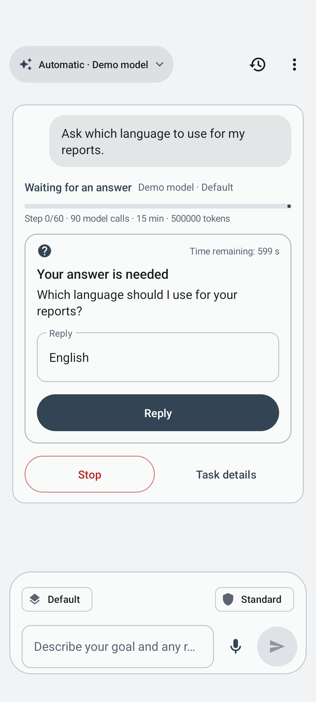
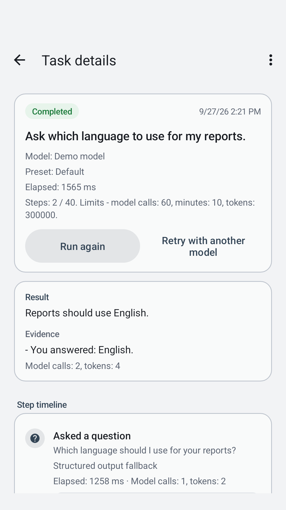
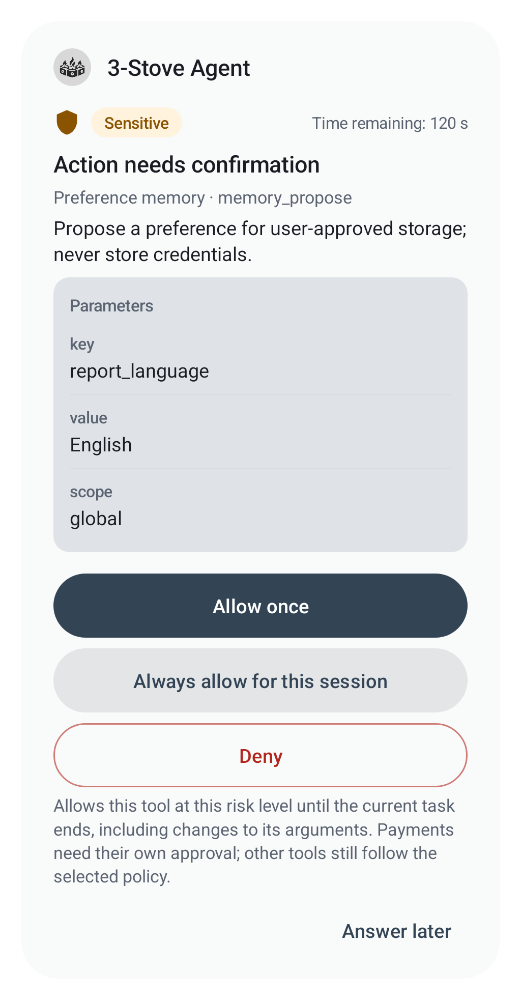
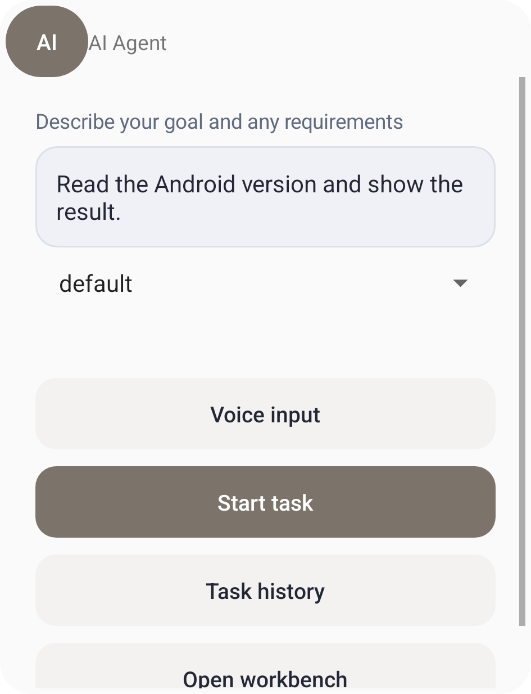

<!--suppress HtmlDeprecatedAttribute, HttpUrlsUsage -->

<div align="center">
  <p>
    <picture>
      <source srcset="https://github.com/SuperMonster003/AutoJs6-Plugin-Three-Stove-Agent/blob/master/app/src/main/res/mipmap-night/ic_launcher.png?raw=true" media="(prefers-color-scheme: dark)" />
      
    </picture>
  </p>

  <p>登録済みスクリプトの選択と画面の段階的な操作により AutoJs6 上で自然言語のタスクを実行</p>

  <p>
    <a href="https://github.com/SuperMonster003/AutoJs6-Plugin-Three-Stove-Agent/releases"></a>
    <a href="https://github.com/SuperMonster003/AutoJs6-Plugin-Three-Stove-Agent/issues"></a>
    <a href="https://github.com/SuperMonster003/AutoJs6-Plugin-Three-Stove-Agent/blob/master/LICENSE"></a>
  </p>
</div>

******

### 言語

******

現在の README.md は以下の言語に対応しています:

- [简体中文 [zh-Hans]](https://github.com/SuperMonster003/AutoJs6-Plugin-Three-Stove-Agent/blob/master/.readme/README-zh-Hans.md)
- [繁體中文 (香港) [zh-Hant-HK]](https://github.com/SuperMonster003/AutoJs6-Plugin-Three-Stove-Agent/blob/master/.readme/README-zh-Hant-HK.md)
- [繁體中文 (台灣) [zh-Hant-TW]](https://github.com/SuperMonster003/AutoJs6-Plugin-Three-Stove-Agent/blob/master/.readme/README-zh-Hant-TW.md)
- [English [en]](https://github.com/SuperMonster003/AutoJs6-Plugin-Three-Stove-Agent/blob/master/.readme/README-en.md)
- [Français [fr]](https://github.com/SuperMonster003/AutoJs6-Plugin-Three-Stove-Agent/blob/master/.readme/README-fr.md)
- [Español [es]](https://github.com/SuperMonster003/AutoJs6-Plugin-Three-Stove-Agent/blob/master/.readme/README-es.md)
- 日本語 [ja] # 現在
- [한국어 [ko]](https://github.com/SuperMonster003/AutoJs6-Plugin-Three-Stove-Agent/blob/master/.readme/README-ko.md)
- [Русский [ru]](https://github.com/SuperMonster003/AutoJs6-Plugin-Three-Stove-Agent/blob/master/.readme/README-ru.md)
- [العربية [ar]](https://github.com/SuperMonster003/AutoJs6-Plugin-Three-Stove-Agent/blob/master/.readme/README-ar.md)

******

### はじめに

******

3-Stove Agent は自然言語の目標を, AutoJs6 が動作する Android デバイス上の実際の操作に変えます. ユーザーがエージェント用に登録したスクリプトを選んでパラメーターを補い実行するか, アクセシビリティのノードツリーを通じて画面を観察し, 観察, 判断, 操作, 検証の循環で段階的に操作します. 目標を達成するか, 確認が必要になるか, 予算を使い切るまで続けます. [AutoJs6 ディスカッション #577](https://github.com/SuperMonster003/AutoJs6/discussions/577) への回答です.

3-Stove Agent は独立したタスク画面と ai.agent で利用する AutoJs6 プラグインを提供します. 組み込み操作とモデル呼び出しは宿主を経由します. MCP ツールはユーザーが設定したサーバーにのみ接続します. Provider に直接接続せず, ユーザー補助権限も要求しません.

******

### 現在の状態

******

1.2.0 は任意の MCP ツール, ネイティブ呼び出し, スクリーンショット観察, 生成スクリプトを提供し, 実機 5 台と API 24 / 35 / 36.1 のエミュレーターで受け入れ検証を終えました. 既知の制限: 小型のローカルモデル (Gemma 4 E2B / E4B) は判断品質が低いこと, 既定の自動接続で VPN の接続先ネットワークが切り替わった後の失敗が未解決であること, UID をまたぐ視覚タスク全体は未検証で AiGoCode gpt-5.6-sol は初期画像とツール結果画像の検証のみ合格していることです. 証拠は [ROADMAP.md](https://github.com/SuperMonster003/AutoJs6-Plugin-Three-Stove-Agent/blob/master/ROADMAP.md) を参照してください.

******

### 機能

******

現在の実装は次の機能を提供します:

- スクリプト選択: `project.json` または `@agent` ヘッダーコメントで登録したスクリプトを, 説明とパラメータースキーマとともにモデルに提示します. エージェントはスクリプトを選び, パラメーターを補い, 必要なら確認を求め, AutoJs6 内で実行して構造化された結果を読み取ります.
- 画面の段階的な操作: エージェントはアクセシビリティのノードツリーをコンパクトなテキストとして観察し (OCR プラグインがあれば画面の文字も読み取り), AutoJs6 の能力ブローカーを通じてタップ, 入力, スクロール, キー操作を行い, 目標を検証できるまで続けます.
- 設計段階からの安全性: 読み取り専用ツールは自動で実行され, 敏感な操作 (支払い, 送信, 削除, ファイル書き込み, shell, 座標ジェスチャー, 敏感として登録されたスクリプト) は既定で確認が必要で, 各実行にはステップ数, モデル呼び出し回数, 実行時間, トークンの予算があります. 確認は今回のみ, またはタスク終了まで許可できます. 設定では慎重モードとフルアクセスも選べ, フルアクセスは確認を省略し目立つ表示が付きます. 決済アプリ一覧と機微なキーワード表は設定のリスク認識画面で拡張でき, 組み込みの項目は削除できません.
- スクリプト API とユーザーインターフェース: `ai.agent.run(goal, options)` はイベント, 応答, キャンセルを備えた `AgentRun` ハンドルを返します. 単独アプリは履歴, プリセット, 設定メモリ, 設定, リリース履歴を備えたタスク画面を提供します.
- ホスト経由のネイティブツール呼び出し: カタログの Schema, バッチ全体の引数検証, 順次実行, 個別確認, 結果による継続とステップ記録で既存のタスク規則を共有
- Android 11+ で AutoJs6 経由のスクリーンショット観察: screen_capture は最長辺 1280, JPEG 品質 70 に変換し, 視覚プロンプト, 画像 token の予算確認, ネイティブツール結果への画像添付に対応
- script_run_source による JavaScript 生成実行: script_dynamic グループは既定で無効です. 毎回ソース要約と展開可能な全文を表示し, 今回のみまたはタスク終了まで許可します. フルアクセスではこの確認を省略します. 実行期限, キャンセル, 構造化結果, 非公開のソース履歴に対応します. UTF-8 ソースとその JSON 文字列はそれぞれ 8 KiB 以下です.
- 選択したローカルまたは外部 MCP サーバーのツールに対応し, サーバーごとにリスクを設定. mcp グループは初期状態で無効
- AutoJs6 プラグインが備えるツール (例えば 3-Macaw Speech の聞き取り, 読み上げ, 文字起こし) はタスク開始時にツール一覧に加わります: 読み取り専用のツールは "プラグインツール" グループ (既定で有効), ファイルを書き込むツールは "プラグインツール (書き込み)" (既定で無効, 呼び出しごとに確認), 出力ファイルは作業ディレクトリの plugin-outputs に保存; ローカルモデルの入力にはこれらのツールが収まらないため, ローカルモデルを使うタスク (自動でローカルモデルが選ばれた場合を含む) では提供しません
- スタンドアロンアプリを Material 3 で再設計しました. ホームはタスクフィードになり, 入力欄はキーボードの上に固定されます. 上部バーにはモデルカプセル, 履歴, メニュー (新しいタスク, プリセット, メモリ, スクリプトフォルダー, MCP サーバー, 設定) があり, 接続の案内は AutoJs6 未接続のときだけ表示されます. ステップのタイムラインは番号ごとに更新され, もう一度実行は入力欄に入力するだけで開始しません. 設定は分かりやすく区分され, 明暗テーマも統一されました
- 音声の入口: 3-Macaw Speech のデジタルアシスタントからの文字と常時待ち受け (ウェイクワードの後の 1 文) はどちらも確認できる下書きになるだけで, フローティングボールの表示中はそのカードに入ります. 録音と認識はすべて 3-Macaw Speech がオフラインで行い, このプラグインはマイク権限を要求しません

### 画面例

Android API 37.1 上の実際の英語画面です. 専用のサンプルタスクと応答を固定したデモモデルを使っています. 実モデルでのタスク成功を示す証拠ではなく, 個人のアカウント情報も含みません. [撮影手順](https://github.com/SuperMonster003/AutoJs6-Plugin-Three-Stove-Agent/blob/master/docs/images/README.md).

| タスク画面 | タスク詳細 |
| --- | --- |
|  |  |
| 操作の確認 | フローティング入力 |
|  |  |

******

### インストール

******

1. AutoJs6 ビルド 5293 以降を導入したデバイスに, [Releases](https://github.com/SuperMonster003/AutoJs6-Plugin-Three-Stove-Agent/releases) からプラグインの APK をインストールします.
2. AutoJs6 プラグインセンターで `3-Stove Agent` が認識されていることを確認します. 公式パッケージは署名検証を通過し, インストール後に確認なしで自動的に有効になります. 明示的に無効化したプラグインは無効のままです. 有効化はプラグインセンターに集約され, スクリプトと独立画面は必要時に接続します. 起動時の自動開始や過去タスクの再実行はありません.

[3-Stone AI](https://github.com/SuperMonster003/AutoJs6-Plugin-Three-Stone-AI) をインストールして有効にし, オンラインモデルを設定するか対応するローカルモデルを取り込んでください. 現在のホスト仲介は 3-Stone AI を選択します. 別の Provider にはホスト側の対応が必要です. モデルは 3-Stove Agent のホームにあるモデルカプセルで選択します. AutoJs6 に接続していない間だけ, ホームに接続の案内が表示されます.

### 互換性

Android 7.0+ (API 24). AutoJs6 6.8.0 / build 5298+ のホストが必要です. このビルドにはタスク API (build 5293+) とネイティブ呼び出しおよび画像入力 (build 5297+) に必要なホスト側の変更がすべて含まれています. 画面操作にはホストのユーザー補助サービスが必要です. Agent はまず AutoJs6 で設定済みの自動起動方法 (Root, セキュア設定または Shizuku) で起動し, 失敗した場合のみ手動での有効化を求めます. OCR は任意で, インストールと認可が済み, ホストが利用可能と報告する OCR プラグインが必要です. 3-Stove Agent 自体はモデル認証情報や独立したユーザー補助サービスを持ちません.

### 画面から開始

3-Stove Agent を開いて AutoJs6 に接続し, 目標を入力して開始します. ホームのモデルカプセルでオンラインまたはローカルモデル, あるいは自動 (端末上のモデルを優先し, なければ最初に利用可能なモデル) を選べます. モデルの検索, よく使うモデルの固定, 最近使ったモデルの再利用ができ, バッジでツール呼び出しと画像入力の対応を確認できます. タスク画面とフローティングボールの新しいタスクはこの選択を共有し, プリセットや実行中のタスクは変更されません. プリセットはモデルを持たなくなりました. 入力欄のプリセットチップで任意のプリセットを選べます. タスクカードで質問への回答と進捗確認ができます.

### スクリプトから開始

3-Stove Agent を接続してモデルを設定した後, AutoJs6 で次の JavaScript を実行します. 質問と確認はプラグイン画面で処理します. 保存済み設定を使うには `preset: "your-preset-name"` を指定します. `plan: true` を加えると, タスクはまず確認用の計画を提案します.

```javascript
let run = ai.agent.run('Android のバージョンを読み取り, 観察した値を報告してください.', {
    tools: ['observe', 'user'],
    interaction: 'plugin',
    budget: { maxSteps: 8 },
});
run.on('progress', (event) => console.log(event.message));
run.result.then(
    (result) => console.log(result.status, result.summary),
    (error) => console.error(error.code, error.message),
);
```

`result.status` を確認してください. Promise が解決しても結果は completed, partial, failed, blocked, cancelled のいずれかです. `run.cancel()` で停止できます. モデル選択やイベント, 予算, スクリプトでの応答は [ai.agent API](https://docs.autojs6.com/#ai) を参照してください. Node.js/Bun/Worker の ai.agent タスク制御とイベント, 登録済みスクリプトのコンテキストと結果, パッケージ化アプリの明示的な認可. AutoJs6 6.8.0 build 5850 が必要です; パッケージ化アプリはホストでアクセスを承認し, タスクループは引き続き 3-Stove Agent が実行します.

### スクリプトの登録

次の例を AutoJs6 作業ディレクトリまたはホスト承認済みディレクトリの `text-counter.js` として保存します. 先頭の `@agent` JSDoc が登録の指定です. 指定したテキストの文字数を数えるよう依頼すると, 必須パラメータが不足する場合は実行前に質問します.

```javascript
/**
 * @agent
 * @description Count Unicode characters in the supplied text
 * @param {string} text Text to count
 * @risk readonly
 * @confirm never
 * @timeout 10000
 */
let context = ai.agent.context();
if (!context) throw Error('Start this registered script through 3-Stove Agent');
let text = new java.lang.String(context.parameters.text);
ai.agent.result({ characters: text.codePointCount(0, text.length()) });
```

プロジェクトでは次の `project.json` を `main.js` の隣に置けます. main.js は上の例と同様に `ai.agent.context().parameters` を読み, `ai.agent.result(...)` を呼び出します. 登録情報は `agent` オブジェクトに置きます.

```json
{
  "name": "Text counter",
  "main": "main.js",
  "agent": {
    "id": "text-counter",
    "description": "Count Unicode characters in the supplied text",
    "parameters": {
      "type": "object",
      "properties": { "text": { "type": "string" } },
      "required": ["text"],
      "additionalProperties": false
    },
    "risk": "readonly",
    "confirm": "never",
    "timeoutMs": 10000
  }
}
```

パラメータ型は string, number, integer, boolean に対応し, 入れ子のオブジェクトや配列は非対応です. sensitive スクリプトはフルアクセス以外では実行前の確認が必要です. レビュー済みスクリプトだけを登録してください. リスク宣言は JavaScript を隔離しません. [完全な登録形式](https://github.com/SuperMonster003/AutoJs6/blob/master/docs/dev/agent-script-manifest-v1.md).

### ツール一覧

この表は同梱の ToolCatalog から生成します. 実際の画面対象によってリスクが上がる場合があり, 慎重モードでは読み取り以外の操作も確認し, フルアクセスでは有効なツールの確認を省略します. 設定, プリセット, タスクオプション, ホスト権限が利用可能なグループを制限します.

| ツール | グループ | リスク | 既定 | 説明 |
| --- | --- | --- | --- | --- |
| `app_launch` | `act` | `NORMAL` | `on` | Open an application by package name or display name. |
| `clipboard_get` | `act` | `READ_ONLY` | `on` | Read clipboard text. |
| `clipboard_set` | `act` | `NORMAL` | `on` | Replace clipboard text. |
| `ui_click` | `act` | `NORMAL` | `on` | Click one observed target. |
| `ui_long_click` | `act` | `NORMAL` | `on` | Long-click one observed target. |
| `ui_press_key` | `act` | `NORMAL` | `on` | Use an Android navigation or notification-panel action. |
| `ui_scroll` | `act` | `NORMAL` | `on` | Scroll one observed target a bounded number of times. |
| `ui_set_text` | `act` | `NORMAL` | `on` | Set or append text on one observed editable target. |
| `files_list` | `files` | `NORMAL` | `off` | List workspace files. |
| `files_read` | `files` | `NORMAL` | `off` | Read bounded workspace file text. |
| `files_stat` | `files` | `NORMAL` | `off` | Read workspace file metadata. |
| `files_write` | `files` | `SENSITIVE` | `off` | Write a workspace file after confirmation. |
| `ui_click_xy` | `gesture` | `SENSITIVE` | `off` | Tap coordinates only with the gesture group enabled and confirmation. |
| `ui_gesture` | `gesture` | `SENSITIVE` | `off` | Follow a bounded coordinate path after confirmation. |
| `ui_swipe` | `gesture` | `SENSITIVE` | `off` | Swipe between coordinates after confirmation. |
| `memory_get` | `memory` | `READ_ONLY` | `on` | Read available preference memory in the current scope. |
| `memory_propose` | `memory` | `SENSITIVE` | `on` | Propose a preference for user-approved storage; never store credentials. |
| `app_current` | `observe` | `READ_ONLY` | `on` | Read the current window and application. |
| `app_installed` | `observe` | `READ_ONLY` | `on` | Check whether an application package is installed. |
| `app_list` | `observe` | `READ_ONLY` | `on` | List installed applications, optionally filtered by a package name or label fragment; the result is bounded. |
| `console_tail` | `observe` | `READ_ONLY` | `on` | Read bounded recent console lines; they may include unrelated scripts. |
| `device_info` | `observe` | `READ_ONLY` | `on` | Read device information. |
| `screen_capture` | `observe` | `READ_ONLY` | `auto (vision)` | Capture the unlocked screen for the selected vision model when text nodes are insufficient. Returns a scaled JPEG observation, not device coordinates. |
| `screen_state` | `observe` | `READ_ONLY` | `on` | Read whether the screen is on. |
| `ui_dump` | `observe` | `READ_ONLY` | `on` | Observe the current accessibility tree before choosing an action. |
| `ui_find` | `observe` | `READ_ONLY` | `on` | Find nodes matching all selector conditions. |
| `ui_wait_for` | `observe` | `READ_ONLY` | `on` | Wait for a selector to appear or disappear within a deadline. |
| `ocr_screen` | `ocr` | `READ_ONLY` | `auto (OCR)` | Read screen text through the host OCR plugin. |
| `script_catalog` | `script` | `READ_ONLY` | `on` | Find scripts explicitly registered for Agent use. |
| `script_list` | `script` | `READ_ONLY` | `on` | List script executions currently running in AutoJs6 with their ids and states. |
| `script_run` | `script` | `NORMAL` | `on` | Run a registered script by id with validated parameters and its registered risk. |
| `script_stop` | `script` | `NORMAL` | `on` | Stop an owned script execution. |
| `script_run_source` | `script_dynamic` | `SENSITIVE` | `off` | Run generated Rhino JavaScript with host script privileges after individual source approval. No sandbox. Source including JSON escaping <=8192 UTF-8 bytes. Use ai.agent.result(value) for results. |
| `shell_exec` | `shell` | `SENSITIVE` | `off` | Execute a bounded non-root shell command after confirmation. |
| `report_progress` | `user` | `READ_ONLY` | `on` | Report bounded progress without declaring task completion. |

### プリセットと記憶

タスク画面のプリセットから設定を保存します. 名前はスクリプトと記憶の固定識別子です. 別名にするには複製してください. 組み込みの default は編集できますが削除できません. プリセットはモデルを含みません. 以前のバージョンでプリセットに保存したモデルはスクリプト用にのみ残ります. タスクの設定はプリセットの制限をさらに縮小できます. 固定とタスクのコンテキストは合計 8 KiB までです. 記憶は全体と現在のプリセット, 片方のみ, または無効を選べます. 編集や削除は待機中のタスクに影響しません. 非公開領域に最大 32 件 / 1 MiB を保存します. プリセットは JSON にエクスポートでき, インポートは 1 件ずつ確認します. ファイルにモデルは含まれず, このデバイスにないツールグループやスクリプトディレクトリはインポート時に除外されます. 計画モードでは, モデルがまず 3 から 8 個の手順を提案し, あなたが確認 (編集可) してから実行します. 計画が合わなくなると新しい計画を提案します. 既定ではオフです.

記憶画面で設定を確認, 編集, 削除またはバックアップできます. 上限は 500 件 / 256 KiB で, スコープ, 元のタスクと日時を保持します. memory_propose とインポートは各項目を個別に確認してください. 不明なプリセットは先に作成が必要です. 自動注入は許可された範囲の新しい完全な項目から最大 4 KiB, 同じ key では現在のプリセットを優先します. memory: false は自動注入のみ停止します. 検索と提案も停止するには memory ツールグループか記憶スコープを無効にします. エクスポートは実際の値と出典を含みます. 認証情報は保存しないでください. 識別可能な認証用キーとトークン形式は拒否されます.

### 使い方

- ランチャーの "スクリプトディレクトリ" で追加フォルダーを設定します. 1 行に 1 つの絶対パスを入力し, 保存後にホストが検証して適用します. タスクは承認済みの範囲だけを絞り込めます.
- 最大 200 件 / 32 MiB. 終了済みタスクのうち最も長く閲覧されていないものから削除されます. 再実行は元の目標とプリセットをタスク画面に入力します. 確認して開始ボタンを押すと実行されます. 履歴の消去時も実行中のタスクは保持されます. 診断用の回数, ツール名, 確認結果を保存します. 目標, 引数, 観察内容, スクリプト結果は除去されます. 保存先を選択してください. 詳細ページの要約を共有は目標, 状態, 要約, 根拠, 未完了項目をシステムの共有シートに渡し, 観察内容は含めません.
- 前面ではタスク画面で回答し, 背景では高優先度の通知から該当するリクエストを開きます. 確認画面にツール, 引数, リスクと残り時間を表示します. このセッションでは常に許可は, タスク終了まで同じツールの同じリスクの操作を許可し, 以降の記憶の提案や生成ソースにも適用されます. 支払いは別途許可が必要です. 回答の記憶は許可されたスコープ内で別の memory_propose を作成します. 通常の確認は 120 秒, 質問は最大 10 分で, タスクの予算も適用されます. 時間切れは USER_TIMEOUT として返り, モデルが再質問か部分完了を選びます. 古いリクエストでは新しい質問に回答できません. 背景の通知は権限とチャンネル設定に従います.
- タスク画面の設定でツール群, 予算, 操作権限 (標準, 慎重, フルアクセス), 音声入力と標準プリセットを選択できます. 変更はすぐに保存され, 新しいタスクに適用されます. フルアクセスは支払いを含む有効なツールを承認なしで実行し, 有効な間はタスク画面, フローティングボール, 履歴に警告表示が出ます. gesture/files/shell/script_dynamic/plugin_write は初期状態で無効, OCR にはホストで利用可能な許可済みプラグインが必要です. 自動に設定した上限は初期値を使い, 時間は分単位で入力し, 設定はプロトコル上限に従います. プリセットと個別指定は制限を狭める場合のみ有効です. データ管理は件数とバイト数を表示し, 実行中タスクがない場合に確認後カテゴリーを消去できます. プリセット消去は組み込み default に戻します. プリセット, メモリ, スクリプトフォルダー, MCP サーバーも設定から開けます. タスク通知は異常通知と完了通知の 2 行に集約され, 各行から通知, toast, ダイアログを個別に設定できます. 初期値は異常時に 3 項目すべて, 完了時に通知と toast を有効にし, 保存済みの選択は維持します. 正常終了 (エラーのない部分完了を含む) は 1 回だけ通知し, キャンセルや履歴表示では通知しません. ワークベンチでは権限チップで操作権限を直接切り替え, プリセットチップのシートでプリセットを選択, 管理し, 右上メニューでフローティングボールを切り替えられます.
- ホーム右上のメニューから設定を開きます. 言語, ダークモード, テーマ色は AutoJs6 に従うか個別に設定できます. 言語とダークモードは Android にも従えます. バージョン履歴と法的情報はオフラインで読めます. 手動の GitHub 更新確認は成功結果を 24 時間保存します. 自動確認は既定で無効です. 有効にするとアプリ使用中のみ 12 時間に最大 1 回試行し, 失敗や無視したバージョンは通知せず, APK を自動ダウンロードしません. 無視した更新の管理でバージョンごとに通知を戻せます. 情報画面ではバージョン, 開発者, ソースコード, ライセンス, サードパーティー通知を確認できます. 独立設定を平面グループ, 統一した行と中央の角丸ダイアログに統一しました. 言語, 夜間モード, テーマ色, ランチャーアイコンは確定後に適用され, キャンセルでは保存値を変えません. 色は既定で AutoJs6 に従い, 共通パレット, HEX/RGB 入力と局所プレビューを提供します. 中立な背景色は固定し, コントロールは選択したテーマに従います. ランチャーの既定は自動適応で, 更新時には明示的な選択を保持します.
- 設定でフローティングボールを有効にし, 他のアプリの上への表示を許可します. 初期状態では無効で, AutoJs6 の接続中のみ表示し, ロック時や切断時に隠れます. 待機中のフォアグラウンドサービスはありません. ドラッグで移動し, タップで目標とプリセットの入力, 質問や確認への回答, タスクの停止ができます. カードを閉じると確認通知が再び表示されます. テキストの共有, 新規タスクのショートカット, プリセット画面からの固定目標付きショートカットを利用できます. どの入口も編集可能な下書きを開き, 開始ボタンで実行します. 削除されたプリセットを自動置換しません. 音声認識は画面の言語を使用し, 利用できなければ非表示です. 結果は入力欄に戻し, 自動送信しません. 3-Macaw Speech がインストールされていれば, 認識アプリを尋ねずに既定でそのオフライン認識を使います (設定でオフにできます). 3-Macaw Speech のデジタルアシスタントで話した後 "3-Stove Agent" をタップした場合も下書きになるだけです. フローティングボールの表示中はそのカードに入り (以前の下書きを置き換え, 選択中のプリセットは維持), それ以外はタスク画面で開きます. 設定の常時待ち受け (初期値はオフ) は 3-Macaw Speech を通じてウェイクワード (既定は 小炉小炉 または Hey Stove, 変更可) を待ち, 検出後に 1 文を聞き取ります. その文も下書きになるだけです (フローティングボールのカード, タスク画面, またはロック中やオーバーレイ権限がない場合の通知). 3-Stone AI, 3-Stove Agent, 3-Macaw Speech のうち常時待ち受けできるのは同時に 1 つだけです. オンの間は常駐通知が 2 つになり電池の消費が増えます. 他のアプリが録音中はウェイクワードを聞き取れません. 起動時には自動で始まらず, タスク画面や設定を開くと再開し, 再起動や更新の後は再開を促す通知が出ます. 待ち受け時間は 10 / 30 / 60 分後に自動でオフ, または常にオンを選べます. "充電中のみ待ち受け" をオンにすると電源を外したときに一時停止し (録音しません), つなぎ直すと再開しますが, Android 14 以降はバックグラウンドでマイクを開き直せないため, 通知のタップで再開します. ColorOS / MIUI では自動起動とバッテリー最適化の除外が必要な場合があり, ないと常駐サービスが終了されることがあります.

### よくある質問

**なぜ AutoJs6 が必要ですか?**

プラグインはタスクループと画面を担当し, AutoJs6 はモデル接続, ユーザー補助操作, 登録スクリプト実行を担当します. 互換ホストに接続していなくても履歴は読めますが, 新しい端末タスクは開始できません. 切断で実行中タスクは blocked となり, 再接続しても自動再実行しません.

**支払いはいつ確認されますか?**

支払いは独立した機密操作です. 注文やスクリプト, 他の操作の承認は支払いの承認ではありません. 既定では検出した支払い操作ごとに個別確認が必要で, 時間切れは拒否として扱います. 支払いの確認でこのセッションでは常に許可を選ぶと, 同じタスク内のそのツールの以降の支払いだけを許可します. フルアクセスは支払いの確認も省略するため, 信頼できる目標とモデルでのみ有効にしてください. 承認前に店舗, 商品, 住所, 金額を確認してください.

**ローカルモデルの制限は何ですか?**

モデルの読み込み成功はタスク成功を保証しません. 記録済みの Gemma 4 E2B IT Wi-Fi 決定検証は不合格で, この対象は JSON を維持します. ネイティブ呼び出しにも対応ホストと対象が必要で, 引数検証, 確認, 予算を適用します. 小さなタスクから開始し partial/failed を確認してください. 古い端末ではローカルモデルの最初の呼び出しが 5 分のモデル制限時間を超えることがあります: Sony G8441 (Snapdragon 835, メモリ 4 GB) では Gemma 4 E2B の読み込みに約 3 分, 入力の処理に約 1 分かかり, 5 分以内に応答がありませんでした. Sony XQ-DQ72 では Gemma 4 E4B で同じタスクが約 70 秒で完了しました. 新しい端末ではこの段階は十数秒で済みます: 2026-11-06 の実測では, Xiaomi Pad 6 Pro (Snapdragon 8+ Gen 1, メモリ 12 GB) で Gemma 4 E2B の返答のみのタスクがコールドスタートから約 18 秒 (モデルの読み込み約 5 秒, 入力の処理約 9 秒), Gemma 4 E4B では約 40 秒で完了し, OnePlus OPD2413 (ColorOS 15) では Gemma 4 E2B で約 14 秒, 画面オフ時は約 19 秒でした. ローカルモデルの回答を待つ間, タスク画面に待機秒数が表示されます. 呼び出しがタイムアウトした場合, 結果に考えられる原因 (モデルの読み込み中, システムによる AI プラグインのバックグラウンド制限, 入力が大きすぎる) と対処法が示されます. リポジトリの .python ディレクトリにある device_local_model_check.py は, 接続した端末でコールドスタートとウォームエンジンの各段階の所要時間を測定します. 画像入力には画像対応の対象が必要で, AiGoCode gpt-5.6-sol は初期画像とツール結果画像の検証に合格しました. 他の対象は個別に検証する必要があります. 生成スクリプトは明示的な有効化が必要で, 各ソースは確認設定に従います.

******

### 権限とセキュリティ

******

プラグインは明確な境界に従います:

- 権限一覧: org.autojs.permission.PLUGIN (ホスト契約の入口), FOREGROUND_SERVICE と FOREGROUND_SERVICE_SPECIAL_USE (タスク実行中のフォアグラウンドサービス), POST_NOTIFICATIONS (バックグラウンドでの確認と進捗通知), INTERNET (GitHub リリースの手動または自動確認と, ユーザーが設定した MCP サーバーへの接続), ACCESS_LOCAL_NETWORK (Android 17+ で MCP 設定からのみ要求), SYSTEM_ALERT_WINDOW (設定でフローティングボールを有効にした場合のみ要求). ユーザー補助, ストレージ, マイクの権限は要求せず, モデル通信はプラグインを経由しません. RECEIVE_BOOT_COMPLETED は常時待ち受けがオンのときに再起動後の再開通知を出すだけで, サービスは起動しません. 常時待ち受けの録音は 3-Macaw Speech が行います.
- Binder 契約の入口は org.autojs.permission.PLUGIN の署名権限で保護されます. ランチャー (ショートカットを含む) と text/plain ACTION_SEND 共有先は公開されていますが, サイズ制限付きの目標とプリセットの下書きだけを受け付けます. 外部 Intent はタスク実行, 確認回答, 権限変更を行えません. 設定, 音声結果, タスク制御は非公開です. 3-Macaw Speech のデジタルアシスタントに応答する音声下書きの入口 (org.autojs.plugin.action.VOICE_COMMAND) も公開されていますが, テキストのみを受け取り下書きの上限で切り詰め, タスクを開始することはできません. 常時待ち受けサービス (スイッチがオンの間だけ有効) とその設定の入口は org.autojs.permission.PLUGIN で保護され, 3-Stone AI と 3-Macaw Speech が常時待ち受け中のアプリを確認し, このプラグインの設定を開くためだけに使われます. AutoJs6 プラグインセンターの "プラグインの設定ページを開く" の入口 (action org.autojs.plugin.THREE_STOVE_AGENT_SETTINGS, meta-data org.autojs.plugin.SETTINGS_ACTION で宣言) も org.autojs.permission.PLUGIN で保護され, このプラグインの設定を開くだけです.
- 3-Stove Agent は独立したタスク画面と ai.agent で利用する AutoJs6 プラグインを提供します. 組み込み操作とモデル呼び出しは宿主を経由します. MCP ツールはユーザーが設定したサーバーにのみ接続します. Provider に直接接続せず, ユーザー補助権限も要求しません.
- モデル認証情報は Provider が保持し, モデル呼び出しは AutoJs6 を経由します. MCP Bearer トークンは Android Keystore で暗号化して専用領域に保存し, プロンプトや履歴エクスポートに含めません. INTERNET は設定済み MCP サーバーにも使用します. Android 17+ のローカルネットワーク権限は MCP 設定から要求します. サーバー別リスクの初期値は SENSITIVE です. キャンセルは遠隔操作を元に戻さず, 失敗した呼び出しを自動再実行しません.
- プラグインツールは AutoJs6 の plugin_tools 経由で呼び出され, 有効化され AutoJs6 に許可されたプラグインだけが対象です (ユーザーが個別に許可したサードパーティプラグインは含まれません). ツールの説明と結果は信頼できないデータとして扱い, そこで認識された文字を指示とはみなしません; 書き込みグループのツールはフルアクセスでない限り呼び出しごとに確認します. 呼び出しのタイムアウトやタスク停止時はプラグインに取り消しを求め, 失敗した呼び出しを自動で再実行しません.
- タスク履歴, プリセット, 設定メモリはプラグインの非公開ストレージにのみ保存されます. バックアップとデバイス間の転送は無効です.
- AutoJs6 の設定と一緒にエクスポートする場合 (AutoJs6 6.8.1 以降), エクスポートには MCP サーバーのアクセストークンが含まれます. トークンが設定されていると AutoJs6 はこのプラグインを既定で選択せず, 選択するとこの部分を暗号化して保存します. エクスポートしたファイルはトークンそのものと同じように保管してください. 設定のエクスポートとインポートの入口は org.autojs.permission.PLUGIN で保護され, AutoJs6 だけが呼び出します. インポートでフルアクセスが有効になることはなく, タスク履歴, プリセット, メモリ, モデルの選択はエクスポートされません. Android のバックアップとデバイス間の転送は引き続き無効です.
- スクリーンショットは AutoJs6 経由で選択したモデルへ送信されます. オンラインモデルの場合もあります. 画面が起動中でロック解除済みであることが必要です. 履歴には寸法やバイト数を保存し, 画像内容は保存しません. JSON 決定では別の観察や回答まで現在の画像を保持します. ネイティブ会話は各バッチとセッションの上限内で過去の画像を保持し, 各ラウンドで token を再予約します.
- 生成スクリプトは JavaScript サンドボックスなしで AutoJs6 の権限を使い, 有効なツールグループを超えた操作も可能です. 全文は非公開の手順に保存され, 既存のパスワード除去と履歴保持規則に従います. 後のパスワード除去で変更されたソースは元のスクリプトとして保存できません. .js の共有前に内容を確認してください.
- フルアクセスはプラグインの非公開設定でのみ有効にでき, モデル出力, 画面内容, スクリプトの要求, 外部 Intent では有効化も拡大もできません. 支払いを含む有効なツールの確認を省略しますが, 追加のツールグループは有効にせず, 予算とホストの権限は維持します. ユーザー補助は AutoJs6 で設定した方法でホストが起動し, プラグイン自体はユーザー補助の権限を要求しません.

プラグインは公式の [Releases](https://github.com/SuperMonster003/AutoJs6-Plugin-Three-Stove-Agent/releases) ページまたは AutoJs6 のプラグインセンターからのみ入手してください. 出所不明のパッケージは, バージョン番号が同じに見えてもホストの検証に失敗したり, リスクを伴う可能性があります.

******

### プラグインインターフェース

******

以下の情報は AutoJs6 ホストおよびプラグインの開発者向けです. ホストはこれらの識別子を使ってプラグインを検出し, 互換性を交渉します:

```text
application id: io.github.supermonster003.autojs6.plugin.three.stove.agent
plugin id: three-stove-agent
engine: three-stove-agent
variant: default
service action: org.autojs.plugin.THREE_STOVE_AGENT
service category: three-stove-agent
service process: :agent
info action: org.autojs.plugin.INFO
aidl interface: org.autojs.plugin.three.stove.agent.api.IThreeStoveAgentPlugin
minimum host build: 5298 (6.8.0)
```

`ThreeStoveAgentPluginService` / `IThreeStoveAgentPlugin` / `IThreeStoveAgentLink`: ホスト認証付き接続でタスクの待機列, 応答, 取消, 照会と非公開の手順履歴を提供; ホスト切断時は停止状態になり, プロセス再起動で自動再開しない.

******

### ロードマップ

******

プラグインの計画と進捗は ROADMAP.md にチェック可能なリストとして管理され, 段階ごとに受け入れ基準と証拠レベルが付いています. 未チェックの項目は現在の機能ではなく意図を表します. Issues での議論を歓迎します.

- [ROADMAP.md を見る](https://github.com/SuperMonster003/AutoJs6-Plugin-Three-Stove-Agent/blob/master/ROADMAP.md)

******

### リリース履歴

******

#### v1.4.1

_2026/11/20_

- `修正` 3-Stove Agent で設定したスクリプトディレクトリが AutoJs6 の要件を満たさない場合 (ディレクトリが存在しない, 共有ストレージ外にある, AutoJs6 の作業ディレクトリの親ディレクトリであるなど), 初回接続では理由を示さず 15 秒のタイムアウトだけが表示され, 接続済みの状態でディレクトリを変更したときにしか受け付けられなかったことが表示されない問題を修正. AutoJs6 6.8.1 は接続リクエストを受け取った時点でディレクトリが拒否されたことを返し, 3-Stove Agent はディレクトリの要件をすぐに表示します (AutoJs6 6.8.0 ではこれまで通りタイムアウト後に表示). 設定画面の説明と通知の文言を AutoJs6 の実際のルールに合わせました (以前は "作業ディレクトリの親でないこと" だけを記載していましたが, 当時は作業ディレクトリ自体も受け付けられませんでした. AutoJs6 6.8.1 以降は作業ディレクトリ自体も入力できます) (AutoJs6 issue #589)
- `修正` ローカルモデル (3-Stone AI の Gemma 4 など) の呼び出しがモデルの制限時間を超えた場合, タスク結果に MODEL_TIMEOUT のコードしかなく理由が示されない問題を修正. 現在は考えられる原因 (モデルの読み込み中, システムによる AI プラグインのバックグラウンド制限, 入力が大きすぎる) と対処法を示し, モデルを提供するプラグインが 20 秒以内に AutoJs6 に応答しなかった場合も別途示します (後者は AutoJs6 6.8.1 が必要) (AutoJs6 issue #589)
- `修正` response_format を受け付けても適用しない OpenAI 互換サービス (智譜 GLM など) を使うと, モデルの応答が Markdown フェンスで囲まれ, タスクが常に DECISION_UNPARSABLE で失敗していました (2 回の修正でもフェンスが残る); 現在は応答内の最初の JSON オブジェクトが有効であればそれを使って続行し (ステップ記録の parseMode は EXTRACTED), ワークベンチの進行状況の行にこのモデル提供元が応答スキーマを無視していることを表示します; ネイティブツール呼び出しモードでフェンス付きの ask / done テキスト応答も同様に受け付けます (issue #1)
- `改善` "AutoJs6 に接続" をタップしたあと, AutoJs6 が実行されていないため接続リクエストが届かなかった場合 (ColorOS などでは他のアプリがバックグラウンドで AutoJs6 を起動できません), AutoJs6 を自動で開いて接続を完了します. "AutoJs6 を開く" をタップする必要はありません. 起動時の自動接続では AutoJs6 に切り替わりません. AutoJs6 6.8.1 以降 (未公開) が必要です
- `改善` ローカルモデルの回答を待つ間, ワークベンチの進行状況の行に待機の理由と待機秒数を表示し, モデルが回答すると今回の待機時間を表示します (スクリプトには通常の progress イベントとして届きます). 端末チェックスクリプト .python/device_local_model_check.py を追加し, 接続した端末でローカルモデルのコールドスタートとウォームエンジンの各段階の所要時間を測定します
- `改善` バージョン履歴のページをリリース履歴のページに改め, バージョンごとに展開, 折りたたみできるようにしました: 折りたたむと日付と分類ごとの項目数を表示し, 展開すると分類名を一度だけ示してその下に項目を並べます; すべてまとめて展開, 折りたたみもでき, 開いたときは最新バージョンが展開され, サブタイトルにプラグイン名を表示します
- `改善` プラグインセンターの使い方の説明を, はじめに, 主な機能, スクリプトでの使い方, 動作要件, よくある質問の 5 部構成に書き直しました
- `改善` 設定ページ右上のメニューに "共通設定ページを開く" を追加し, AutoJs6 にある本プラグインの共通設定ページを開けるようにしました (AutoJs6 6.8.1 以降が必要, それより前のバージョンではこのメニュー項目は表示されません)
- `依存関係` three-stove-agent-api ローカルモジュールを更新 (出典: AutoJs6 ホストビルド 52ba898be7, ハッシュ固定), 接続結果の判定でその定数を直接参照 (新しい理由コード ROOTS_REJECTED (スクリプトディレクトリが受け付けられなかった) を含む)
- `依存関係` Jetpack Compose BOM バージョン 2026.09.00 と androidx.activity:activity-compose バージョン 1.12.2 を追加 (リリース履歴のページ)

#### v1.4.0

_2026/11/05_

- `ヒント` AutoJs6 と一緒に設定をエクスポート, インポートするには AutoJs6 6.8.1 以降 (未公開) が必要です. それより前の AutoJs6 では, このバージョンは 1.3.0 と同じように使えます
- `機能` プラグインの設定を AutoJs6 の設定と一緒にエクスポート, インポートできるようになり, 機種変更や再インストールのあとに設定し直す必要がなくなりました: ツールグループ, タスクの制限, 操作の権限 (標準 / 慎重), 音声入力とフローティングボールのスイッチ, 異常通知と完了通知の方法, リスク認識に自分で追加したパッケージ名とキーワード, 言語, ダークモード, テーマ色, MCP サーバー (アクセストークンを含む) が含まれます. モデルの選択, プリセット, タスク履歴, メモリは含まれません. MCP サーバーにアクセストークンがあるときは, エクスポート時にこのプラグインは既定で選択されず, 選択すると AutoJs6 がこの部分を暗号化して保存します (別の端末でインポートするには, エクスポート時にパスワードを設定してください). フルアクセスはインポートでは有効にならず, その端末の設定でのみ有効にできます. AutoJs6 で "前回のインポートを元に戻す" を行うと, インポート前のこの端末のフルアクセスに戻ります. インポートした設定はすぐに反映され, 言語, ダークモード, テーマ色は次にプラグインの画面を開いたときに反映されます. インポートした MCP サーバーは既存の一覧に追加されますが, タスクの実行中は MCP サーバーを置き換えないため, タスクが終わってからもう一度インポートしてください. 新しい端末では, オーバーレイ権限を許可するとフローティングボールが表示されます
- `改善` AutoJs6 への接続に失敗したときの案内を具体的にしました: 15 秒以内に接続できない場合は次の手順 (AutoJs6 が実行されていないとき, ColorOS などのシステムでは他のアプリがバックグラウンドで AutoJs6 を起動できないため "AutoJs6 を開く" をタップして接続する, それでも接続できない場合はプラグインセンターで承認と有効化を確認し, 両方を最新バージョンに更新する) を示します. AutoJs6 6.8.1 以降では AutoJs6 が返した理由 (無効など) と対処方法を表示し, 接続リクエストが AutoJs6 に届かなかった場合も 15 秒を待たずにすぐ知らせます
- `依存関係` common-plugin-api ローカルモジュールを 1.1.1 に更新 (出典: AutoJs6 ホストビルド 1676e7489d, ハッシュ固定), 設定のエクスポートとインポート用
- `依存関係` org.json バージョン 20231013 を追加 (JVM テストのみ)

#### v1.3.0

_2026/10/22_

- `機能` Node.js/Bun/Worker の ai.agent タスク制御とイベント, 登録済みスクリプトのコンテキストと結果, パッケージ化アプリの明示的な認可 (AutoJs6 6.8.0 build 5850 が必要です; パッケージ化アプリはホストでアクセスを承認し, タスクループは引き続き 3-Stove Agent が実行します)
- `機能` リスク認識を設定可能に: 設定にリスク認識画面を追加し, 組み込みの決済アプリ一覧 (Alipay, AlipayHK, UnionPay, PayPal, Google ウォレット, Samsung Pay, Huawei Wallet, Mi Pay) と 10 言語の機微なキーワード表に独自のパッケージ名とキーワードを追加できます. 追加は一覧を広げるだけで即時に反映され, 一致した画面操作は機微な操作として確認を経ます
- `機能` フローティングボールを刷新: 最小化時はタスクと現在のステップを 2 行で表示し, 文字をタップするとステップのタイムラインカードが開きます. コントロールカードはワークベンチと同じ 2 行 (プリセット / モデル / アクセス権限, 入力欄 / 音声 / 開始) にまとめ, モデルとアクセス権限はオーバーレイ内で切り替えてアプリと同じ選択を共有します. タイムラインは末尾にいる間は新しいステップを追いかけ, 上にスクロールすると止まり, 末尾に戻ると再開します (タスク詳細画面も同様)
- `機能` プリセットのインポート / エクスポート: プリセット画面に JSON のインポートとエクスポートを追加. エクスポートしたファイルには全プリセットの設定が含まれ, モデルは含まれません. インポートは 1 件ずつ確認し, 同名のプリセットには置き換えの注意を表示し, このデバイスにないツールグループやスクリプトディレクトリはインポート時に除外され, 確認の途中で画面を離れても再開できます
- `機能` 観察ツールの補完: 読み取り専用ツール app_list (インストール済みアプリの一覧, パッケージ名または名前の一部で絞り込み可能, 最大 200 件), app_installed (パッケージがインストール済みかの確認), script_list (AutoJs6 で実行中のスクリプトとその ID と状態の一覧, script_stop と組み合わせて使用) を追加. それぞれホストの grant が既に許可していた package_manager.listApps, app.isInstalled, engines.list に対応し, 観察グループとスクリプトグループに属して既定で有効です
- `機能` 計画モード (プリセットのスイッチ, 既定ではオフ. スクリプトは options.plan で上書き可能): オンにするとモデルはまず 3 から 8 個の手順を提案し, タスク画面, フローティングボール, 確認画面に編集可能な計画確認カードが表示されます. 承認後, ランタイムは計画を毎回のプロンプトに添えて順番どおりの実行を求め, 計画が合わなくなるとモデルは新しい計画を提案して再確認を求めます. 決定スキーマに計画モードでのみ受け付ける plan 分岐が加わり, タイムラインと履歴に計画の手順が記録されます
- `機能` タスク結果の共有: タスク詳細のメニューに要約を共有を追加. 目標, 状態と要約, 根拠, 未完了項目のプレーンテキストをシステムの共有シートに渡します. 観察内容, 引数, スクリプト結果, エラー詳細が非公開の履歴から出ることはなく, タスクの実行中はこの項目を使えません
- `機能` タスク通知は異常通知と完了通知の 2 行に集約され, 各行から通知, toast, ダイアログを個別に設定できます. 初期値は異常時に 3 項目すべて, 完了時に通知と toast を有効にし, 保存済みの選択は維持します. 正常終了 (エラーのない部分完了を含む) は 1 回だけ通知し, キャンセルや履歴表示では通知しません
- `機能` 独立設定を平面グループ, 統一した行と中央の角丸ダイアログに統一しました. 言語, 夜間モード, テーマ色, ランチャーアイコンは確定後に適用され, キャンセルでは保存値を変えません. 色は既定で AutoJs6 に従い, 共通パレット, HEX/RGB 入力と局所プレビューを提供します. 中立な背景色は固定し, コントロールは選択したテーマに従います. ランチャーの既定は自動適応で, 更新時には明示的な選択を保持します.
- `機能` 音声入力で 3-Macaw Speech のオフライン認識を直接使えるようになりました. 3-Macaw Speech がインストールされていると, マイクは使う認識アプリを毎回尋ねずに既定でそれを開きます. 設定に"3-Macaw Speech のオフライン認識を優先する"スイッチが加わり (3-Macaw Speech がある場合のみ表示), オフにするとシステムが認識アプリを選びます. 音声認識アプリのない端末では, 3-Macaw Speech をインストールして認識モデルをダウンロードすればオフラインで認識できることも設定の説明で案内します
- `機能` 3-Macaw Speech のデジタルアシスタントの送り先として使えるようになりました. 3-Macaw Speech に話しかけた後 (電源ボタンの長押しなど) "3-Stove Agent" をタップすると, 認識した文字がタスクの下書きになります. フローティングボールの表示中はそのカードに入力され (以前の下書きを置き換え), それ以外はワークベンチで開きます. 確認して開始を押すまで何も実行されないため, 聞き間違いが端末の操作になることはありません
- `機能` 常時待ち受け (設定の新しいスイッチ, 初期値はオフ, 3-Macaw Speech とそのウェイクワードモデルおよび認識モデルが必要): ウェイクワード (既定は "小炉小炉" または "Hey Stove", 5 個まで変更可, 感度 3 段階) に続けてタスクを話すと, その文が下書きになります. フローティングボールの表示中はそのカードに入り, それ以外はワークベンチで開き, ロック中やオーバーレイ権限がない場合は通知になります. 開始を押すまで実行されません. 録音は 3-Macaw Speech が行い, このプラグインはマイク権限を要求しません. 3-Stone AI, 3-Stove Agent, 3-Macaw Speech のうち常時待ち受けできるのは同時に 1 つだけで, すでにオンのアプリがあればスイッチがその名前を示し, その設定を開けます. オンの間は 3-Stove Agent と 3-Macaw Speech がそれぞれ常駐通知を表示し, 電池の消費が増えます. 起動時には自動で始まりません. ワークベンチや設定を開くと再開し, 再起動や更新の後は再開を促す通知が出ます (新しい RECEIVE_BOOT_COMPLETED 権限はこの通知にだけ使います)
- `機能` 常時待ち受けに時間制限を設定できます: 設定の常時待ち受けスイッチの下に "待ち受け時間" (10 / 30 / 60 分後に自動でオフ, または常にオン. 既定は常にオン) と "充電中のみ待ち受け" (既定はオフ) を追加. 時間になるとスイッチがオフになり常駐通知も消えます. 常駐通知と設定にはオフになる時刻を表示し, 再起動や更新の後にその時刻を過ぎていればスイッチはオフのままで, 再開を促す通知も出ません. 充電中のみ待ち受け: 電源を外すと一時停止して 3-Macaw Speech は録音を止め, つなぎ直すと再開します. Android 14 以降はバックグラウンドでマイクを開き直せないため, 通知に "タップして待ち受けを続ける" と表示され, タップするかタスク画面や設定を開くと再開します
- `機能` タスクで AutoJs6 プラグインのツールを使えるようになりました: 有効なプラグイン (例えば 3-Macaw Speech) が備えるツールはタスク開始時にツール一覧に加わり, エージェントは一言聞き取る, 文章を読み上げる, 音声ファイルを文字起こしする, といった操作ができます. 設定のツールグループに "プラグインツール" (読み取り専用, 既定で有効, アップデート時も有効になります) と "プラグインツール (書き込み)" (ファイルを書き込む, 既定で無効, 呼び出しごとに確認) が加わりました; 保存先を指定しない出力ファイルは作業ディレクトリの plugin-outputs に保存されます. ローカルモデルを使うタスク (自動でローカルモデルが選ばれた場合を含む) ではプラグインツールを提供しません. 定義がローカルモデルの入力に収まらないためです. AutoJs6 6.8.0 正式版が必要です
- `修正` 入力欄が複数行になっても送信ボタンが 1 行目に留まらず, マイクボタンと同じく下端に揃うようにしました
- `修正` 計画モードの計画リクエストでは, ネイティブツール呼び出しに対応したオンラインモデルにツール定義を渡さなくなりました. モデルはツールを直接呼び出せず計画だけを返します (実機で Codex 系モデルが 3 回続けて計画ではなくツール呼び出しを返し, タスクが DECISION_UNPARSABLE で失敗していました). 計画の承認後はネイティブツール呼び出しに戻ります
- `修正` ネイティブツール呼び出しの継続ラウンドは, 最初のリクエストに残っていたモデルタイムアウトを引き継がなくなりました. 各ラウンド (モデルがツール呼び出しを返し, ツールを実行し, 次のリクエストを送る) は毎回完全なモデルタイムアウトを得て, ターン全体はタスクの所要時間予算とラウンド上限だけに制限されます. 実機では 5 分を超えるネイティブタスク (複数回のスクリーンショット後に電卓を読むなど) がちょうど 300 秒で MODEL_TIMEOUT により終了していました. AutoJs6 5298 より新しいホストと 3-Stone AI 1.2.1 より新しいビルドが必要で, 三者とも同じくラウンドごとにリセットします
- `修正` その他メニューのフローティングボールのチェックボックスにアプリのテーマ色を適用
- `修正` インストール時に自動アイコンの配色が固定される問題を修正し, ランチャーが設定に応じて明暗のリソースを読み込めるようにしました.
- `修正` タスク終了時の実行照会が, ごく短い間だけ終了状態を返しながら結果を含まないことがありました (リモート CI の偽ホスト適合テストが時折失敗): 終了状態は結果と同時にアーカイブへ書き込まれるようになり, ホストとスクリプトが結果のない終了タスクを見ることはなくなりました
- `修正` 更新設定で不足していた翻訳を補完
- `修正` アラビア語の画面で 3-Stove Agent が Stove Agent-3 と逆順に表示されなくなりました
- `修正` バージョン履歴のリンクはリンクの文字だけを表示し, Markdown の記号や URL をそのまま表示しなくなりました (アラビア語ではこの部分の順序が乱れていました)
- `修正` タスク画面の "AutoJs6 を開く" は, AutoJs6 がすでに開いているときに反応しませんでした. 今は接続要求が毎回 AutoJs6 に届きます. 本プラグインが使えないとき (プラグインセンターで無効にされている, まだ許可されていないなど) は, ダイアログを出さずに AutoJs6 がプラグインセンターを開いて 3-Stove Agent を表示します (この点は AutoJs6 6.8.0 の正式版が必要です)
- `修正` 既定のツールグループで, ローカルモデルのタスクが最初のモデル呼び出しの前に LIMIT_EXCEEDED で失敗しなくなりました: ローカルモデル向けのプロンプトでは登録済みスクリプトの規則を短くし, 登録済みスクリプトがないときは丸ごと省き, 計画の規則は計画モードのときだけ含めます
- `改善` 別のモデルで再試行ボタンを廃止 (モデルはワークベンチ上部またはフローティングボール内で切り替え). フローティングボールのタスク履歴とワークベンチを開くはその他メニューにまとめ, 履歴アイコンを標準の字形に変更
- `改善` MCP サーバーが tools/list_changed を送った後は, 次の呼び出しの前に凍結済みのツール定義を再確認します. 定義が変わっていなければそのまま続行し, 変わった場合にのみ MCP_CATALOG_CHANGED で失敗して, MCP 設定でツール選択を更新してからタスクをやり直すようユーザーに促すことをモデルに伝えます. エンドポイントの説明に OAuth ログインと従来の HTTP+SSE トランスポートが未対応であることを追記しました
- `改善` 1.2.0 で導入した一回限りの移行を削除しました. ワークベンチの下書き設定にある古いモデル選択は model-selection.json へ自動的に移されなくなったため, それ以前のバージョンで保存したモデルはワークベンチで選び直してください
- `改善` 設定の"音声入力を有効にする"スイッチに説明が付きました. マイクは音声認識アプリがインストールされている場合にのみ表示され, 認識はそのアプリが行い, このプラグインは録音しません. 音声認識アプリのない端末 (一部の中国向け ROM など) ではスイッチをオンにしてもワークベンチにマイクが現れない代わりに, その理由をその場で表示します
- `改善` プラグインセンターを唯一の有効化スイッチに統一. 公式パッケージはインストール後に確認なしで自動的に有効になり, 明示的な無効化は維持されます. スクリプトと独立画面は必要時に接続し, 起動時の自動開始やタスク再実行は追加しません
- `改善` アプリ情報のアイコンの角丸枠を保ち, 透明な内側に周囲と同じページ背景を表示します. ランチャーの選択肢を先頭から表示し, 説明を小さくしました.
- `改善` ホストがモデルソースをヒューズしたためにタスクが失敗した場合 (RATE_LIMITED: FUSED), 結果に原因と対処 (しばらく待って再試行, 続く場合は AutoJs6 を再起動) を表示します. ホスト側もタイムアウトしたブロッキングトランザクションが返った時点でヒューズを自動解除し, 以降のタスクに再起動は不要です
- `改善` ランチャーとプラグインセンターのアイコンの見た目の大きさを統一し, 透明な背景と白黒または無彩色のグレースケールを使用
- `改善` プラグインセンターのアイコンに Icon Studio で調整したサイズ, 位置, 明暗の図稿と円形背景を適用し, 再生成可能な原稿とパラメーターを保持
- `改善` Android のアプリ情報アイコンに Icon Studio と共通の図案と明暗の背景色を使用し, プラグインセンターの透明な図案と既存のランチャー設定を維持
- `改善` タスクの内容がモデルの入力上限を超えて失敗した場合 (LIMIT_EXCEEDED), 結果の説明にサイズの内訳が 1 行加わります: リクエスト全体のバイト数, 適用された上限, システムプロンプト, ツール説明, タスク文, 観察結果など各部分のバイト数で, どの部分が大きすぎるかを判断できます. この行は数値とツールグループ名だけで, タスク文, 画面の内容, メモリは含みません

##### さらに詳しいリリース履歴

* [CHANGELOG.md](https://github.com/SuperMonster003/AutoJs6-Plugin-Three-Stove-Agent/blob/master/app/src/main/assets/doc/CHANGELOG-ja.md)

******

### ビルドと検証

******

このセクションはソースからプラグインをビルドしたい開発者向けです. 通常のユーザーは Releases ページのビルド済み APK をインストールするだけで済みます.

デバッグ APK をビルドする:

```powershell
.\gradlew.bat :app:assembleDebug
```

JVM ユニットテストを実行し, インストルメンテーションテスト APK をビルドする:

```powershell
.\gradlew.bat :app:testDebugUnitTest :app:assembleDebugAndroidTest
```

リリース APK をビルドする:

```powershell
.\gradlew.bat :app:assembleRelease
```

リリース成果物を収集し, ファイル名にバージョンと CRC32 ダイジェストを追加する:

```powershell
.\gradlew.bat :app:appendDigestToReleasedFiles
```

多言語ドキュメントのソースと生成物が同期していることを検証する (CI でも実施):

```powershell
py .python\generate_markdown.py --check
```

ビルドには JDK 21 以降と Android SDK 37 が必要です. Gradle とプラグインのバージョンは `version.properties` と `io.github.supermonster003.autojs6-platform-versions` で一元管理されます.

******

### ローカライズとドキュメント生成

******

```text
.readme/common.json
.readme/lang_*.json
.readme/template_readme.md
.readme/template_plugin_instruction.md
.changelog/lang_*.json
.changelog/template_changelog.md
.python/generate_markdown.py
app/src/main/assets/doc/CHANGELOG-*.md
app/src/main/res/raw-*/plugin_instruction.md
```

`.readme/` と `.changelog/` の言語 JSON ファイルが README, プラグインセンターの説明, 変更履歴の唯一のソースです. 常にこれらの JSON ソースを編集して `py .python/generate_markdown.py` を再実行してください. 生成された README, `plugin_instruction.md`, 変更履歴は手で編集しません. `py .python/generate_markdown.py --check` を実行するとすべての生成物を検証できます.

******

### ライセンス

******

プロジェクトのコードは [Mozilla Public License 2.0](https://github.com/SuperMonster003/AutoJs6-Plugin-Three-Stove-Agent/blob/master/LICENSE) の下で提供されます. サードパーティのコンポーネントとそのライセンスは [サードパーティ通知](https://github.com/SuperMonster003/AutoJs6-Plugin-Three-Stove-Agent/blob/master/THIRD_PARTY_NOTICES.md) に記載しています.

******

### リンク

******

- AutoJs6 プロジェクト: https://github.com/SuperMonster003/AutoJs6
- AutoJs6 ドキュメント: https://docs.autojs6.com
- AutoJs6 ディスカッション #577: https://github.com/SuperMonster003/AutoJs6/discussions/577
- サードパーティ通知: https://github.com/SuperMonster003/AutoJs6-Plugin-Three-Stove-Agent/blob/master/THIRD_PARTY_NOTICES.md
